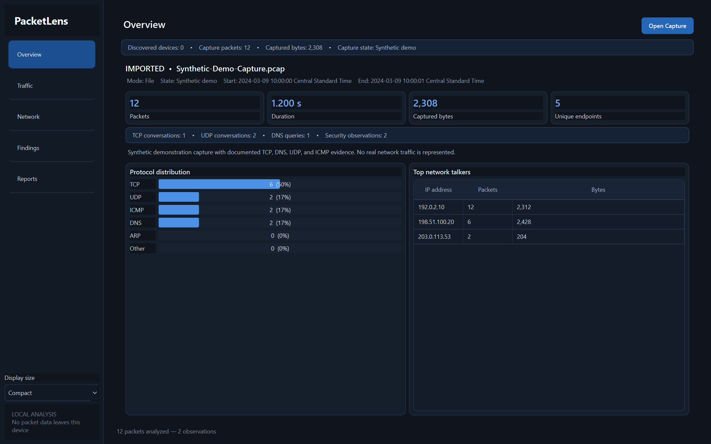
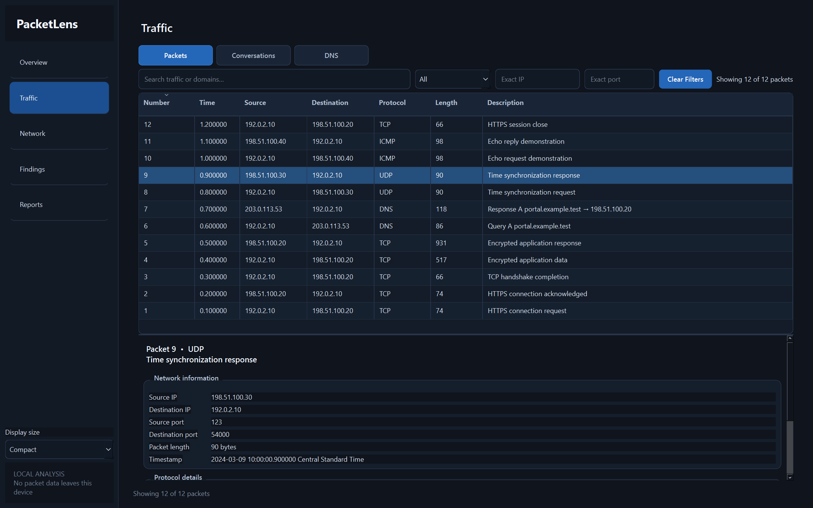
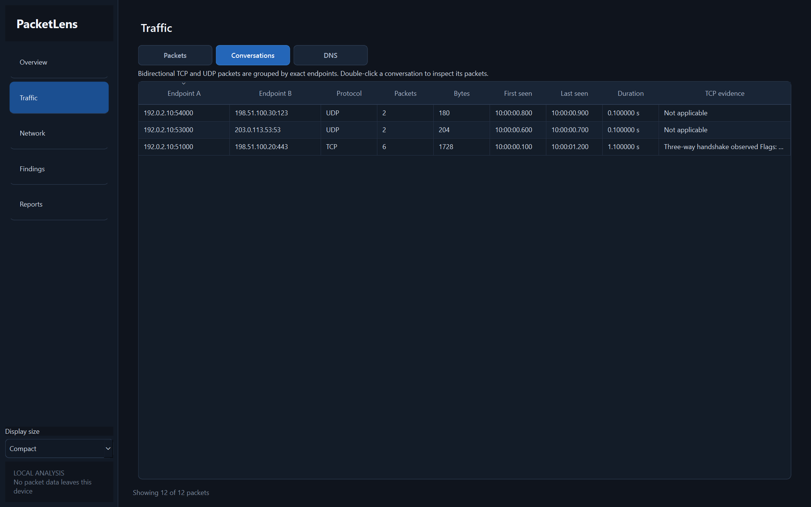
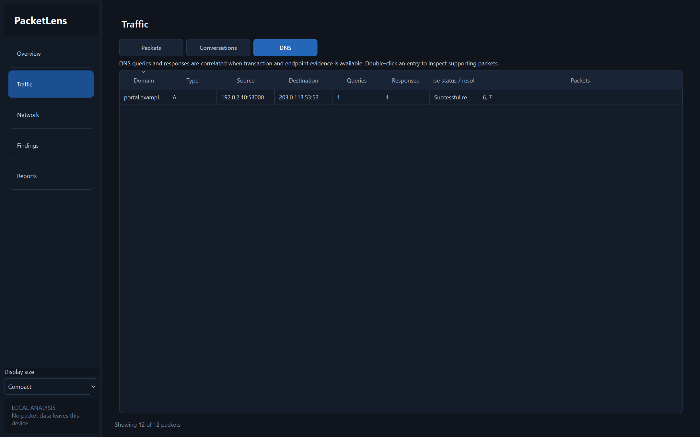
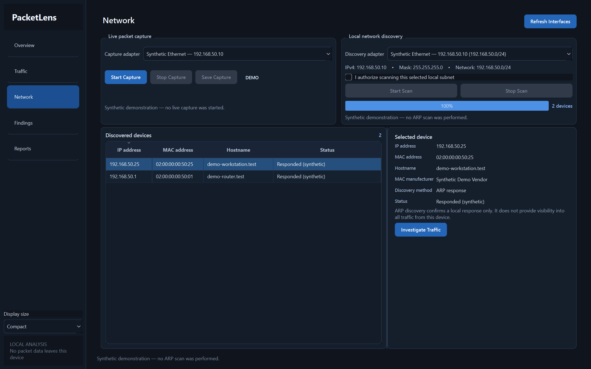
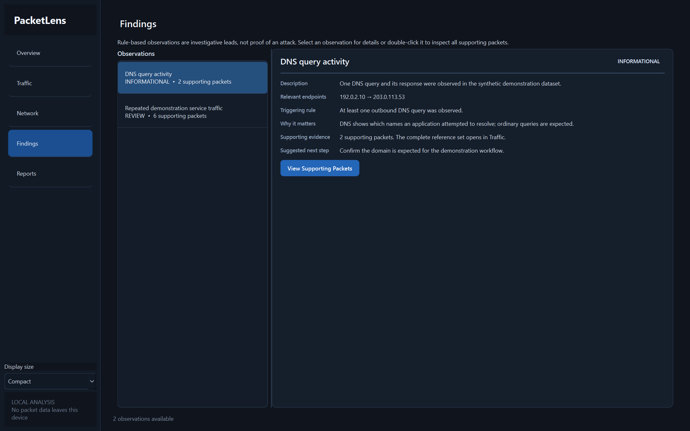
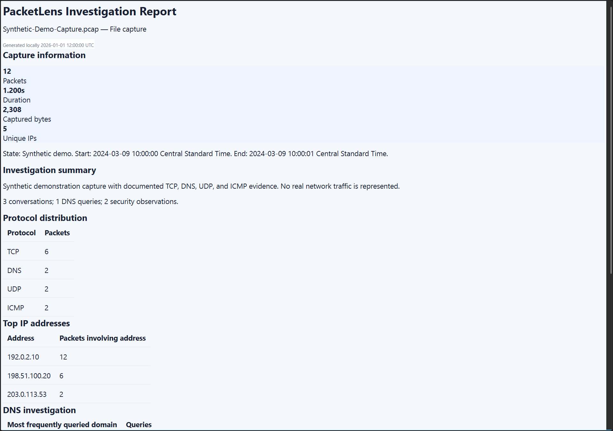

# PacketLens

PacketLens is a Windows desktop packet analyzer designed to make network traffic more understandable to beginners and cybersecurity learners. It presents packet evidence, conversations, DNS activity, local-device discovery, and conservative rule-based observations in a modern PySide6 interface.

PacketLens performs analysis locally. It is an educational investigation tool, not an intrusion-detection system and not proof that activity is benign or malicious.

Current local compliance candidate: **0.8.4** (not published)

## Features

- Authorized live packet capture through a separately installed copy of Npcap
- Offline PCAP and PCAPNG analysis without Npcap
- TCP, UDP, DNS, ICMP, ARP, IPv4, and IPv6 inspection
- Bidirectional TCP and UDP conversation summaries
- Correlated DNS query and response investigations
- Explicit, native-Npcap local-subnet ARP discovery with cancellation and bounded work
- Device-to-traffic filtering using exact IP addresses
- Conservative rule-based security observations linked to supporting packets
- Search, protocol, exact-IP, and exact-port traffic filters
- Locally generated, HTML-escaped investigation reports
- Compact, comfortable, and large display scaling
- Bounded live capture sessions with PCAP saving and reopening

## Screenshots

All screenshots use deterministic synthetic demonstration data and do not represent a real security incident or network.

| Overview | Packet inspection |
| --- | --- |
|  |  |

| Conversations | DNS investigation |
| --- | --- |
|  |  |

| Network discovery | Findings |
| --- | --- |
|  |  |



## Windows installation from source

PacketLens does not currently offer a public prebuilt Windows executable. This
repository is being prepared for source-only publication.

Requirements:

- 64-bit Windows 10 or Windows 11
- Python 3.11 or newer (the v0.8.4 candidate is tested with Python 3.14.10)
- An independently installed copy of [Npcap](https://npcap.com/) for live
  capture and ARP discovery; offline PCAP/PCAPNG analysis works without it

From a local source checkout:

```powershell
py -m venv .venv
.venv\Scripts\python.exe -m pip install --upgrade pip
.venv\Scripts\python.exe -m pip install -r requirements.txt
.venv\Scripts\python.exe main.py
```

PacketLens does not download, install, or redistribute Npcap. Confirm that your
intended installation and organizational use are permitted by Npcap's current
license; redistribution requires a separate OEM arrangement. PacketLens never
automatically captures, scans, or requests administrator privileges.

## Usage

### Analyze an existing capture

Select **Open Capture**, choose a PCAP or PCAPNG file, and wait for local analysis. Overview summarizes the capture; Traffic exposes individual packets, conversations, and DNS activity.

### Capture live traffic

Open **Network**, select the intended capture adapter, then choose **Start Capture**. Use **Stop Capture** before saving. PacketLens never starts capture automatically, installs drivers, or requests elevation.

### Investigate conversations and DNS

On **Traffic**, select **Conversations** to review normalized TCP/UDP flows or **DNS** to review correlated query and response evidence. Double-click a row to filter Traffic to its complete supporting packet set.

### Review findings

Open **Findings**, select an observation, and review its rule, endpoints, rationale, evidence count, and suggested next step. **View Supporting Packets** opens the complete evidence set in Traffic. Findings are investigative leads, not attack determinations.

### Discover local devices

On **Network**, select an eligible private local IPv4 adapter, review the proposed subnet, confirm authorization, and explicitly start the scan. Discovery uses ARP only; it does not perform port or vulnerability scanning.

### Save and report

Stopped live captures can be saved as PCAP files. The **Reports** page exports a local HTML summary with escaped capture-derived content.

## Architecture

- **Python** implements analysis, orchestration, tests, and build tooling.
- **PySide6** provides the Windows desktop interface.
- **dpkt** parses offline PCAP/PCAPNG files and normalizes native live frames.
- A standard-library **ctypes** adapter uses an independently installed **Npcap** for live interface enumeration and capture; PacketLens does not bundle its DLLs or driver.
- **PyInstaller** creates the windowed portable onedir distribution.

PacketLens does not bundle or install Npcap.

## Privacy and safety

PacketLens processes packet data locally and does not intentionally upload captures, addresses, or reports. Capture files can contain sensitive payloads, hostnames, addresses, and credentials; protect them accordingly.

Only capture traffic or discover devices on networks you own or are explicitly authorized to inspect. PacketLens does not automatically capture, scan, elevate privileges, exploit devices, test credentials, or perform port scanning.

## Limitations

- Live capture and ARP discovery require a compatible Npcap installation and sufficient local permissions.
- Offline PCAP/PCAPNG analysis remains available without Npcap.
- Results are limited to packets actually present; incomplete, lossy, filtered, or one-sided captures can change conclusions.
- Switched networks normally expose only traffic visible to the selected host/interface unless intentionally configured otherwise.
- Encrypted traffic generally exposes metadata rather than decrypted application content.
- Detection rules are deliberately conservative heuristics and cannot guarantee identification of malicious activity.
- Port numbers and traffic volume do not prove application identity or intent.
- This release candidate was tested on Windows 11 x64. Windows 10 x64 is intended but has not been clean-machine verified for this release candidate; non-Windows systems and 32-bit Windows are unsupported.
- The executable is unsigned and may trigger Windows reputation warnings. Do not disable Windows security protections to run it.

## Development

Python 3.11 or newer is recommended for source development. The 0.8.4 compliance candidate is built and tested with 64-bit Python 3.14.10.

```powershell
py -m venv .venv
.venv\Scripts\python.exe -m pip install --upgrade pip
.venv\Scripts\python.exe -m pip install -r requirements.txt
.venv\Scripts\python.exe main.py
```

Run the tests without live capture or scanning:

```powershell
.venv\Scripts\python.exe -m unittest discover -s tests -v
```

Build the Windows distribution:

```powershell
.venv\Scripts\python.exe -m pip install -r requirements-build.txt
.\build_windows.ps1
```

The build script runs tests, invokes the maintained [PyInstaller specification](PacketLens.spec), probes the frozen application, validates distribution contents, and creates the portable ZIP and SHA-256 file. Release archives, build directories, captures, reports, and local environments are deliberately excluded from Git.

## Security and contributing

See [SECURITY.md](SECURITY.md) for private-reporting guidance and [CONTRIBUTING.md](CONTRIBUTING.md) for development expectations. Verified milestones are recorded in [CHANGELOG.md](CHANGELOG.md). Dependency licensing is summarized in [THIRD_PARTY_NOTICES.md](THIRD_PARTY_NOTICES.md); Qt source availability and runtime-replacement procedures are documented in [QT_SOURCE_AVAILABILITY.md](QT_SOURCE_AVAILABILITY.md) and [QT_LIBRARY_REPLACEMENT.md](QT_LIBRARY_REPLACEMENT.md).

## License

The original PacketLens source code is licensed under the
[Apache License 2.0](LICENSE).

That license applies only to original PacketLens material the project owner is
authorized to license. It does not replace or relicense Python, PySide6, Qt,
Shiboken6, dpkt, PyInstaller, Npcap, or other third-party components. Their
licenses and notices are documented in
[THIRD_PARTY_NOTICES.md](THIRD_PARTY_NOTICES.md) and
[`THIRD_PARTY_LICENSES`](THIRD_PARTY_LICENSES/).
